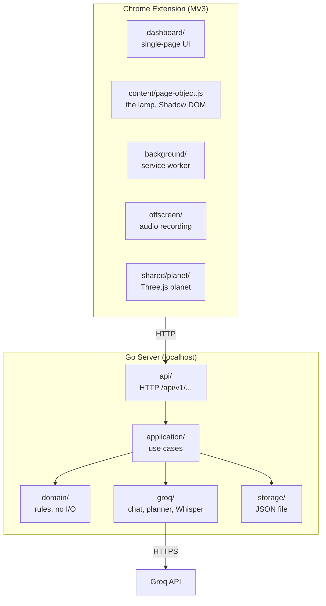

# B-MAX

**A calm, positive-only focus companion for people with ADHD.**

Built for **Open Hackathon 2026**, challenge #11: *"Lost in Space, an ADHD lived experience"*.

B-MAX is a Chrome extension backed by a local Go server. You tell **Max**, a lamp character who lives in the extension, what you want to achieve and what you need to do today. He turns that into one clear priority order, walks with you through the day, brings you back when you drift, and grows a planet that tracks your progress toward your life goal.

Everything works by voice and by keyboard, so the app is usable without looking at the screen.

> **Design rule, applied everywhere: the app never punishes.** No streak loss, no blocking, no blame, no progress taken away. A hard day brings clouds over your planet, not a lower score.

---

<!-- TODO: replace with a real screenshot or demo GIF. This is the single highest-value addition to this README. -->
<!--  -->

---

## Why

Most productivity tools assume the hard part is knowing what to do. For people with ADHD the hard part is often starting, staying, and coming back after attention breaks. Tools that respond to that with streaks, blocking and guilt make returning more expensive, not less.

B-MAX is built around the opposite assumption: the return is the feature. Losing focus is treated as a normal state transition with a way back, never as a failure.

---

## Features

**Onboarding as a conversation.** Max introduces himself, then asks for your life goal and today's tasks. You can type or speak, in Greek or English. No forms, no empty fields staring at you.

**Dynamic prioritisation.** Tasks are ranked on every turn by deadline, length and relevance to the life goal. The server reorders on its own when a deadline approaches. The first task starts by itself: there is no start button to forget.

**Time estimation.** Max asks how long a task needs, once. If you do not know, he estimates from the kind of task and offers the estimate as a proposal rather than a rule.

**Tracking and return.** Max measures time on relevant pages, asks whether you finished when the time passes, and when you drift to a distraction site he offers one button that takes you back to the page you were actually on.

**A planet tied to the life goal, not to task count.** Each task carries an impact from 0 to 3; the goal has a size in points. Taking a shower moves nothing, a real step does. New eras are celebrated. A rough day brings clouds and lightning: a mood, never a penalty, cleared by one finished task.

**Idea chest.** A place to throw thoughts into without losing your current task. Ideas stay. Each can later become a task or be deleted. Max brings an old idea back when you have been on distraction sites with nothing finished, once a day, without saying why.

**The lamp on every website.** Click it and Max comes out, listens, keeps the task or idea, and folds back. The microphone works there too.

**Voice.** Dictation with silence detection via Groq Whisper, which handles Greek with English technical words. Max can also speak, in the dashboard and in pop-ups on any tab.

**Accessibility as a requirement, not an afterthought.** Spoken pop-ups, spoken status with no AI call (`Alt+Shift+S` reports your current task, what follows, and the planet in words), keyboard shortcuts for every important action, live regions, high contrast, large text, reduced-motion support and skip links.

**Bilingual.** Full Greek and English switch affecting replies, interface, dictation and cards.

---

## Architecture

Two parts: a local **Go server** that owns every rule, and a **Chrome MV3 extension** that is purely the interface. No product logic lives in JavaScript.



### Why it is built this way

**Rules in Go, never in JS.** The extension can be reloaded, inspected and tampered with. Keeping prioritisation, progress and planet state server-side means the behaviour is testable and consistent.

**The AI sits behind a boundary.** Planning and conversation call the Groq API, but the app is designed to survive without it. Prioritisation scoring is deterministic and rule-based, so it keeps working when the provider rate-limits or fails. Onboarding falls back to a simple generated plan when the model does not answer.

**Engineering around the model.** The chat prompt is kept to roughly 1200 tokens and only the last 10 turns are sent, because Groq rate-limits tokens per minute. A 429 is surfaced to the user with the number of seconds to wait rather than failing silently. Every call logs its duration and token counts.

**Confirmed progress only.** The planet moves when the user confirms a step, never from elapsed time or inference. Progress the user did not earn makes the whole world feel fake.

---

## Getting started

### Prerequisites

- Go 1.24 or newer
- Google Chrome
- A [Groq API key](https://console.groq.com) for the chat and the microphone

### Run the server

```bash
git clone https://github.com/edibim/B-Max.git
cd B-Max

export GROQ_API_KEY="your-groq-api-key"
go run ./cmd/server          # listens on 127.0.0.1:8787
```

Check it is up: <http://127.0.0.1:8787/api/v1/health>

### Load the extension

1. Open `chrome://extensions`
2. Enable **Developer mode**
3. Click **Load unpacked** and select the `extension` folder
4. Open the dashboard. The first run starts a chat with Max.

### Configuration

| Variable | Default | Purpose |
| --- | --- | --- |
| `GROQ_API_KEY` | required | Chat, planning and speech-to-text |
| `GROQ_MODEL` | `openai/gpt-oss-120b` | Planner model |
| `GROQ_CHAT_MODEL` | falls back to `GROQ_MODEL` | Lets the chat use a lighter model |
| `GROQ_STT_MODEL` | `whisper-large-v3` | Speech-to-text |
| `PORT` | `8787` | Server port |
| `DATA_DIR` | see code | Where the JSON state file is written |

### Test tools

The dashboard has a ⚙️ panel for development: reset profile, fast timings, skip to the next day, simulate a 5-day absence, and load a demo profile. These exist because the return-after-absence flow and the planet's era progression cannot be demonstrated in real time.

---

## Tests

```bash
bash scripts/check.sh    # go vet, Go tests, extension tests, code rules
```

The script must end with `ALL CHECKS PASSED`. It covers Go unit tests on the domain and application layers, Node tests for the extension, and headless-Chrome flow tests running against a stubbed AI provider so the suite does not depend on a live model.

---

## Project structure

```
server/
  cmd/server/            entry point
  internal/
    domain/              rules, no I/O
    application/         use cases: chat, tasks, status, idea chest
    api/                 HTTP handlers, /api/v1
    groq/                chat, planner, Whisper
    storage/             JSON file persistence
extension/
  dashboard/             single-page dashboard
  content/               the lamp injected into pages (Shadow DOM)
  background/            MV3 service worker
  offscreen/             hidden page for audio recording
  shared/                chat client, Max's SVG and animations, planet
  tests/                 Node tests
docs/                    architecture, handoff notes, demo script
scripts/check.sh         full check suite
```

---

## Privacy

Everything is stored locally in a JSON file on your machine. The only data leaving the computer is what is sent to Groq: the text of your chat, and recorded audio for transcription. Audio is not stored. Page content is not tracked beyond local keyword matching against your own task list, which never leaves the machine.

---

## Limitations

This is a hackathon build, and the honest boundaries matter for a tool in this space:

- **Not a medical product.** It does not diagnose, treat or replace professional support. The design follows published research summaries and lived experience, but no clinical study was run and no clinical benefit is claimed.
- **Model-dependent behaviour.** Tone and time estimates vary with the model. The rules that matter (one question per task, no blame, progress never drops) are enforced in Go, not left to the model.
- **Not verified in every environment:** audible `chrome.tts` output, keyboard shortcuts in every real Chrome configuration, and behaviour with a real screen reader were not fully tested within the hackathon window.

---

## Team

Built by **Team M.B.A.X.** during Open Hackathon 2026, 25 to 27 September.

I built the Go server and the extension, backend and frontend, including the AI integration, the voice pipeline and the accessibility layer. The 3D planet rendering was built by a teammate.

<!-- TODO: add your teammates' names and GitHub profiles here. Crediting them properly costs nothing and says something about you. -->

---

## License

MIT. See [LICENSE](LICENSE).
